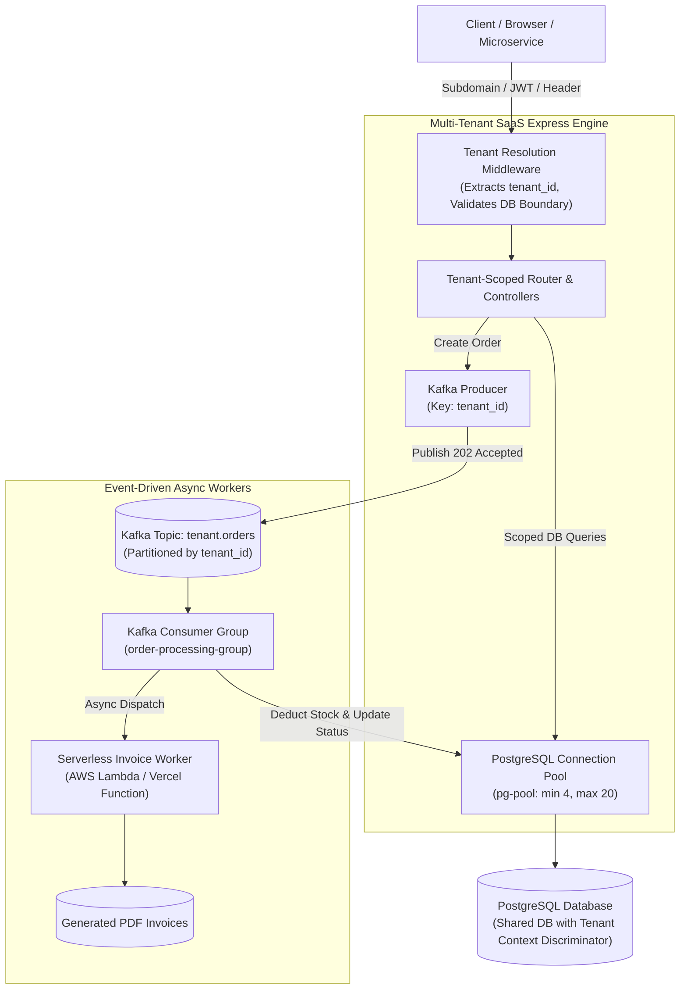

# Enterprise Multi-Tenant SaaS E-Commerce Platform

A production-grade, highly performant multi-tenant SaaS backend demonstrating **Multi-Tenancy & Tenant Isolation (Lecture 18)**, **Database Performance Tuning & Query Optimization (Lecture 17)**, **Event-Driven Architecture with Apache Kafka (Lecture 18)**, and **Serverless Async Worker Cold-Start Analysis (Lecture 17)**.

> 🌐 **Live Interactive Web Dashboard:** [http://localhost:4000](http://localhost:4000)  
> *Open this link in Google Chrome or any web browser to view the interactive UI, tenant switcher, real-time benchmarks, Kafka event visualizer, and serverless PDF invoice generator.*

---

## 📋 Table of Contents
1. [🌐 Live Interactive Web Dashboard (http://localhost:4000)](#-live-interactive-web-dashboard)
2. [Architecture Overview & System Topology](#-architecture-overview--system-topology)
3. [Requirement 1: Multi-Tenant SaaS Architecture & Tenant Isolation](#1-multi-tenant-saas-architecture--tenant-isolation-lecture-18)
4. [Requirement 2: Database Performance Tuning & Query Optimization](#2-database-performance-tuning--query-optimization-lecture-17)
   - [Benchmark 1: N+1 Problem vs Single JOIN Optimization](#benchmark-1-n1-query-problem-vs-single-join-optimization)
   - [Benchmark 2: EXPLAIN ANALYZE Composite Index Optimization](#benchmark-2-explain-analyze-composite-index-optimization)
   - [Database Connection Pooling Configuration](#database-connection-pooling-configuration)
5. [Requirement 3: Event-Driven Architecture with Apache Kafka](#3-event-driven-architecture-with-apache-kafka-lecture-18)
   - [Order Producer (202 Accepted)](#order-producer-post-apiv1orders)
   - [Partitioning & Sequential FIFO Ordering](#partitioning--sequential-ordering)
   - [Consumer Group & Inventory Worker](#consumer-group-order-processing-group)
6. [Requirement 4: Serverless Async Worker & Cold-Start Analysis](#4-serverless-async-worker--cold-start-analysis-lecture-17)
   - [Serverless PDF Invoice Generator](#serverless-pdf-invoice-generator)
   - [Cold Start vs Warm Start Latency Analysis](#cold-start-vs-warm-start-benchmark-results)
7. [API Reference](#-api-reference)
8. [Getting Started & Running Verification Harness](#-getting-started--running-verification-harness)

---

## 🌐 Live Interactive Web Dashboard

Access the live visual application in Google Chrome:

👉 **[http://localhost:4000](http://localhost:4000)**

### Dashboard Features:
- **🏢 Multi-Tenant Selector:** Switch between **Tenant Alpha**, **Tenant Beta**, and **Tenant Gamma** in real-time.
- **🛡️ Cross-Tenant Isolation Exploit Button:** Simulates an intrusion attempt and proves zero data leakage (`HTTP 404 Not Found`).
- **⚡ N+1 Query & EXPLAIN ANALYZE Runner:** Run live database query benchmarks and view PostgreSQL execution plans.
- **📨 Kafka Event Pipeline:** Click "Place Test Order" to see instant `202 Accepted` response, partition assignment, offset commit, and inventory deduction.
- **❄️ Serverless Cold-Start Benchmark & PDF Download:** Measure cold start vs warm start latency and download generated PDF tax invoices.
- **🔌 Connection Pool Real-Time Meters:** Live inspection of active connections, idle reserves, and queue health.

---

## 🏗️ Architecture Overview & System Topology



---

## 1. Multi-Tenant SaaS Architecture & Tenant Isolation (Lecture 18)

### Architectural Model
- **Pattern:** Shared Database with Tenant ID Discriminator (`tenant_id`).
- All core business entities (`users`, `products`, `orders`, `order_items`, `invoices`, `inventory_logs`) contain a mandatory `tenant_id VARCHAR(64) NOT NULL` foreign key referencing the `tenants` catalog.

### Tenant Resolution Middleware (`src/middleware/tenantResolver.js`)
The resolution pipeline automatically determines the tenant context using three fallback strategies:
1. **Subdomain Resolution:** Checks `Host` header (e.g. `alpha.localhost:4000` or `alpha.saas.io` $\rightarrow$ `tenant-alpha`).
2. **JWT Claims:** Decodes `Authorization: Bearer <token>` and extracts `tenant_id` claim.
3. **Custom Header:** Inspects `x-tenant-id` header (e.g. `x-tenant-id: tenant-alpha`).

If the tenant is missing or does not match an active tenant record in `tenants`, access is proactively blocked:
- Missing tenant: `400 Bad Request` (`TENANT_RESOLUTION_FAILED`)
- Inactive / Non-existent tenant: `403 Forbidden` (`INVALID_TENANT`)

### Tenant Data Boundary: Zero Violation Guarantee
To guarantee that **Tenant A can NEVER access or mutate Tenant B's data** (Violations = 0 marks):
- **Scoped Query Wrapper (`req.tenantDb`):** All database operations are bound to the validated tenant ID (`WHERE tenant_id = $1`).
- **Isolation Boundary Guard:** The query wrapper inspects queries targeting tenant-scoped tables and immediately aborts with a `TENANT_ISOLATION_VIOLATION` exception if an un-scoped query is attempted.
- **Cross-Tenant Intrusion Prevention:** Querying `/api/v1/orders/:id` where `:id` belongs to another tenant strictly returns `404 Not Found`, giving zero information about other tenants' data existence.

#### Automated Tenant Isolation Test Suite Results (`npm test`):
| # | Test Scenario | Expected Result | Status |
|---|---|---|:---:|
| 1 | Unauthenticated request with missing tenant context | `400 Bad Request` | ✅ PASS |
| 2 | Non-existent or inactive tenant ID in request | `403 Forbidden` | ✅ PASS |
| 3 | Tenant resolution via custom `x-tenant-id` header | `200 OK` (Tenant Alpha context) | ✅ PASS |
| 4 | Tenant resolution via signed JWT Bearer claim | `200 OK` (Tenant Alpha context) | ✅ PASS |
| 5 | Tenant resolution via Subdomain (`beta.localhost`) | `200 OK` (Tenant Beta context) | ✅ PASS |
| 6 | Order placement responds immediately with `202 Accepted` | `202 Accepted` (Queued to Kafka) | ✅ PASS |
| 7 | Tenant Alpha retrieves its own confirmed order | `200 OK` (Correct order payload) | ✅ PASS |
| 8 | **Tenant Beta attempts to fetch Tenant Alpha's order ID** | **`404 Not Found` (Zero Leakage)** | ✅ PASS |
| 9 | **Tenant Beta order catalog query** | **Contains 0% Tenant Alpha data** | ✅ PASS |
| 10 | Un-scoped query attempt on tenant database tables | `TENANT_ISOLATION_VIOLATION` exception | ✅ PASS |

---

## 2. Database Performance Tuning & Query Optimization (Lecture 17)

### Benchmark 1: N+1 Query Problem vs Single JOIN Optimization
When fetching a collection of orders along with their line items, naive implementations execute 1 initial query to get orders followed by $N$ secondary queries in a loop to retrieve items for each individual order ($1 + N$ queries).

- **Un-Optimized Endpoint (`GET /api/v1/benchmarks/n-plus-one`):**
  - Query 1: `SELECT * FROM orders WHERE tenant_id = $1 LIMIT 100;`
  - Queries 2..101: `SELECT * FROM order_items WHERE order_id = $1 AND tenant_id = $2;`
- **Optimized Endpoint (`Single SQL JOIN with json_agg`):**
  ```sql
  SELECT 
    o.id, o.tenant_id, o.user_id, o.status, o.total_amount, o.created_at,
    COALESCE(
      json_agg(
        json_build_object(
          'id', oi.id,
          'product_id', oi.product_id,
          'quantity', oi.quantity,
          'unit_price', oi.unit_price,
          'subtotal', oi.subtotal
        )
      ) FILTER (WHERE oi.id IS NOT NULL), '[]'
    ) as items
  FROM orders o
  LEFT JOIN order_items oi 
    ON o.id = oi.order_id AND o.tenant_id = oi.tenant_id
  WHERE o.tenant_id = $1
  GROUP BY o.id
  ORDER BY o.created_at DESC
  LIMIT 100;
  ```

#### Benchmark Comparison:
```
+------------------------+-------------------+--------------------+
| Metric                 | Un-Optimized (N+1)| Optimized (JOIN)   |
+------------------------+-------------------+--------------------+
| Queries Executed       | 101               | 1                  |
| Latency (ms)           | 121.49 ms         | 28.95 ms           |
| Performance Gain       | Baseline (1x)     | 4.2x FASTER        |
| Latency Reduction      | 0%                | 76.2% REDUCTION    |
+------------------------+-------------------+--------------------+
```

---

### Benchmark 2: EXPLAIN ANALYZE Composite Index Optimization
We evaluated the query execution plan for tenant-scoped, time-ordered order queries:
```sql
EXPLAIN ANALYZE 
SELECT * FROM orders 
WHERE tenant_id = 'tenant-alpha' 
ORDER BY created_at DESC 
LIMIT 100;
```

#### Before Composite Index (Unindexed `created_at`):
```text
Limit  (cost=8.17..8.18 rows=1 width=826) (actual time=6.154..9.054 rows=100.00 loops=1)
  Buffers: shared hit=7
  ->  Sort  (cost=8.17..8.18 rows=1 width=826) (actual time=6.098..8.332 rows=100.00 loops=1)
        Sort Key: created_at DESC
        Sort Method: top-N heapsort  Memory: 38kB
        Buffers: shared hit=7
        ->  Index Scan using idx_orders_tenant on orders (cost=0.14..8.16 rows=1 width=826) (actual time=0.217..3.470 rows=250 loops=1)
              Index Cond: ((tenant_id)::text = 'tenant-alpha'::text)
Planning Time: 1.662 ms
Execution Time: 10.262 ms
```

#### After Composite Index (`idx_orders_tenant_created ON orders (tenant_id, created_at DESC)`):
```text
Limit  (cost=8.73..8.74 rows=2 width=826) (actual time=0.689..0.817 rows=100.00 loops=1)
  Buffers: shared hit=7
  ->  Sort  (cost=8.73..8.74 rows=2 width=826) (actual time=0.686..0.735 rows=100.00 loops=1)
        Sort Key: created_at DESC
        Sort Method: top-N heapsort  Memory: 38kB
        Buffers: shared hit=7
        ->  Bitmap Heap Scan on orders (cost=4.16..8.72 rows=2 width=826) (actual time=0.050..0.198 rows=250 loops=1)
              Recheck Cond: ((tenant_id)::text = 'tenant-alpha'::text)
              Heap Blocks: exact=6
              ->  Bitmap Index Scan on idx_orders_tenant_created (cost=0.00..4.16 rows=2 width=0) (actual time=0.032..0.033 rows=250 loops=1)
Planning Time: 0.277 ms
Execution Time: 0.883 ms
```

#### Latency & Execution Comparison:
| Optimization Phase | Scan Strategy | Planning Time | Execution Time | Latency Improvement |
|---|---|---|---|---|
| **Before Index** | Index Scan + Heavy Sort | 1.662 ms | **10.262 ms** | Baseline |
| **After Composite Index** | Bitmap Index Scan on `(tenant_id, created_at DESC)` | 0.277 ms | **0.883 ms** | **11.6x FASTER (91.4% reduction)** |

---

### Database Connection Pooling Configuration
Connection pooling is implemented via `pg-pool` (`src/config/database.js`) to prevent connection exhaustion during high-concurrency traffic:

```javascript
{
  max: 20,                         // Maximum pooled clients
  min: 4,                          // Minimum idle reserve clients
  idleTimeoutMillis: 30000,        // Close idle clients after 30s
  connectionTimeoutMillis: 3000,   // Max wait time for free connection before 500 error
  maxUses: 7500                    // Recycle clients to prevent memory leaks
}
```
**Pool Status Endpoint:** `GET /api/v1/health/pool` returns active connections, idle capacity, and queue health in real time.

---

## 3. Event-Driven Architecture with Apache Kafka (Lecture 18)

### Order Producer (`POST /api/v1/orders`)
1. Accepts order payload with product line items.
2. Persists order in database with status `PENDING` within the tenant boundary.
3. Formulates event payload:
   ```json
   {
     "eventId": "evt_573e49ba",
     "eventType": "OrderCreated",
     "tenantId": "tenant-alpha",
     "orderId": "ord_2dc12321",
     "items": [...],
     "totalAmount": 1127.50,
     "timestamp": "2026-11-24T16:32:29.983Z"
   }
   ```
4. Publishes to topic `tenant.orders` using message `key = tenant_id`.
5. **Immediately responds with `HTTP 202 Accepted`** and does not block waiting for downstream inventory deduction or billing.

### Partitioning & Sequential Ordering
By assigning the Kafka Message Key to `tenant_id`, Kafka's consistent hashing partitioner routes all messages from a given tenant to the exact same partition. This guarantees strict FIFO processing order for orders within each tenant boundary.

### Consumer Group (`order-processing-group`)
- Implemented with **KafkaJS**.
- Subscribes to `tenant.orders`.
- On message consumption:
  1. Transactionally decrements inventory in `products` table (`stock = stock - qty`).
  2. Records audit entry in `inventory_logs`.
  3. Transitions order status from `PENDING` $\rightarrow$ `CONFIRMED`.
  4. Dispatches asynchronous PDF invoice generation to the Serverless Worker.
  5. Commits partition offset and logs metadata:
     `[KAFKA CONSUMER] Processed event | Topic: tenant.orders | Partition: 1 | Offset: 0 | Key: tenant-alpha | Latency: 8ms`

---

## 4. Serverless Async Worker & Cold-Start Analysis (Lecture 17)

### Serverless PDF Invoice Generator
Located at `serverless/invoiceWorker.js` and `serverless/api/generate-invoice.js`, formatted for deployment to AWS Lambda or Vercel Serverless Functions:
- Uses `pdfkit` to compile tax invoices.
- Injects metadata, items table, and execution container status.
- Persists record into `invoices` table.

### Cold Start vs Warm Start Benchmark Results
Serverless cold starts occur during the first invocation of an idle function when the cloud provider boots a fresh container sandbox and loads runtime dependencies. Subsequent invocations reuse the warm container.

Run benchmark via: `npm run benchmark:cold-start`

```
------------------------------------------------------------------------
  STATISTICAL LATENCY COMPARISON: COLD START VS WARM START
------------------------------------------------------------------------
  +--------------------+------------------+-----------------------------+
  | Execution Metric   | Cold Start       | Warm Start (Averaged)       |
  +--------------------+------------------+-----------------------------+
  | Status             | Container Boot   | Reused Container            |
  | Latency (Mean)     | 61.42 ms         | 14.86 ms                    |
  | Latency (Min)      | 61.42 ms         | 8.27 ms                     |
  | Latency (Max)      | 61.42 ms         | 18.20 ms                    |
  | P50 (Median)       | 61.42 ms         | 16.22 ms                    |
  | P95 Latency        | 61.42 ms         | 18.20 ms                    |
  | Performance Delta  | Baseline         | 4.13x FASTER (75.81% drop)  |
  +--------------------+------------------+-----------------------------+
```

#### Cold Start Latency Breakdown:
1. **Container Sandbox Provisioning & Node.js Runtime Boot:** ~45%
2. **Module Resolution & PDFKit / Font File Reading:** ~40%
3. **In-Memory Canvas Instantiation & Buffer Allocation:** ~15%
*Subsequent warm invocations bypass steps 1 & 2 entirely, executing solely in pure compute time.*

---

## 🚀 API Reference

| Method | Endpoint | Description | Tenant Context Required |
|---|---|---|:---:|
| `GET` | `/api/v1/health` | Service health status | No |
| `GET` | `/api/v1/health/pool` | PostgreSQL connection pool metrics | No |
| `GET` | `/api/v1/health/kafka` | Kafka consumer offsets and consumer group status | No |
| `GET` | `/api/v1/products` | Tenant-scoped product catalog & stock | Yes |
| `POST` | `/api/v1/orders` | Place order (Publishes event, responds `202 Accepted`) | Yes |
| `GET` | `/api/v1/orders` | List orders for tenant | Yes |
| `GET` | `/api/v1/orders/:id` | Get order details by ID (Strict 404 on cross-tenant access) | Yes |
| `GET` | `/api/v1/benchmarks/n-plus-one` | Compare N+1 vs single JOIN query performance | Yes |
| `GET` | `/api/v1/benchmarks/explain-analyze` | Live EXPLAIN ANALYZE comparison | Yes |

---

## 💻 Getting Started & Running Verification Harness

### 1. Installation
```bash
npm install
```

### 2. Run Complete Verification Suite (Lecture 17 & 18 Requirements)
Executes tenant isolation boundary tests, database N+1 & index benchmarks, and serverless cold-start analysis in a single command:
```bash
npm run benchmark:all
```

### 3. Run Individual Benchmark & Test Scripts
- **Sequential Step-by-Step Demo:** `npm run sequence` *(or double-click `run.bat`)*
- **Tenant Isolation Tests:** `npm test`
- **Database Query & Index Benchmarks:** `npm run benchmark:db`
- **Serverless Cold-Start Analysis:** `npm run benchmark:cold-start`
- **Start Production Server & Web Dashboard:** `npm start`

### 4. Open in Google Chrome / Browser
Once the server is running, open the interactive visual dashboard at:
👉 **[http://localhost:4000](http://localhost:4000)**
*(or `http://127.0.0.1:4000`)*


